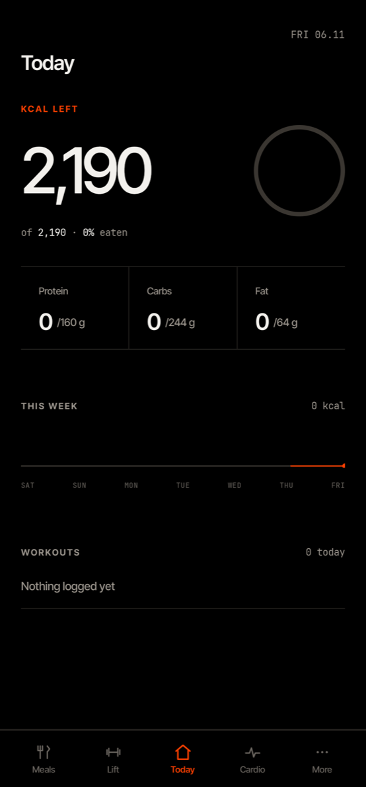
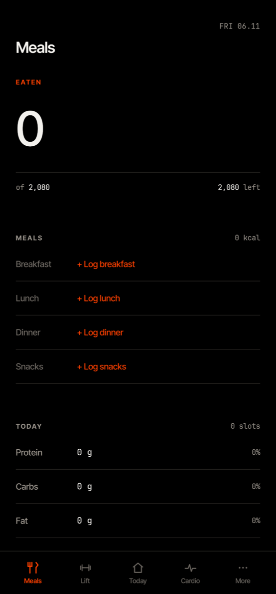
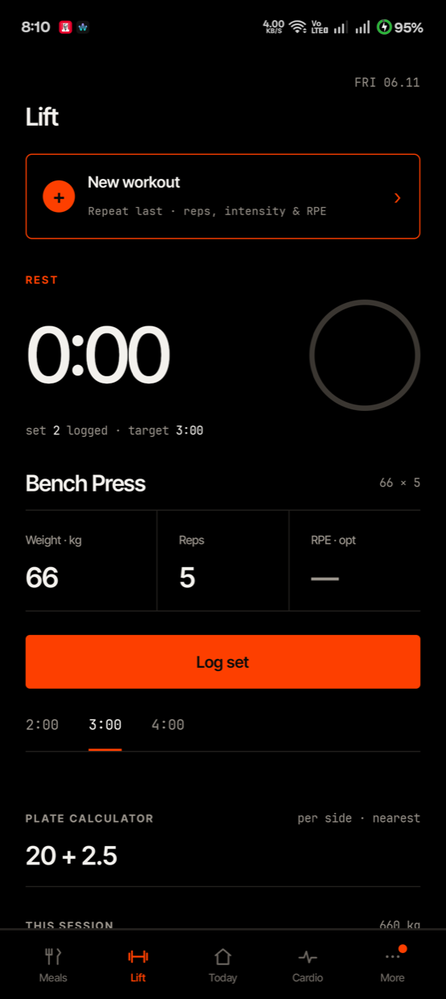
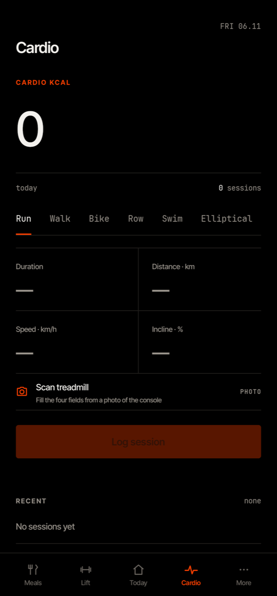
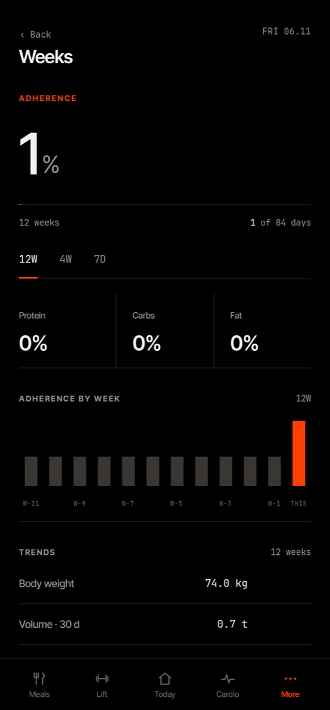
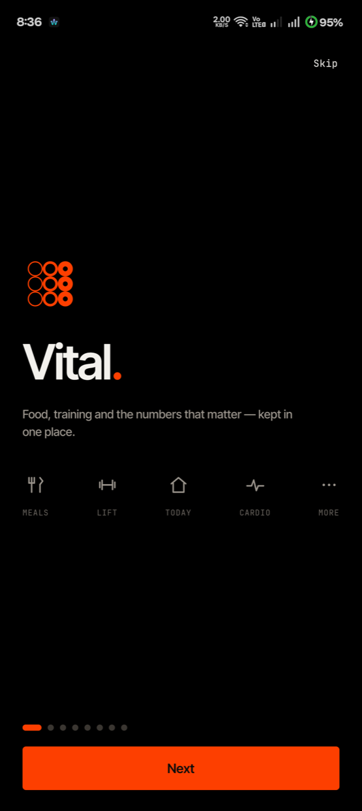
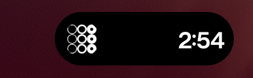
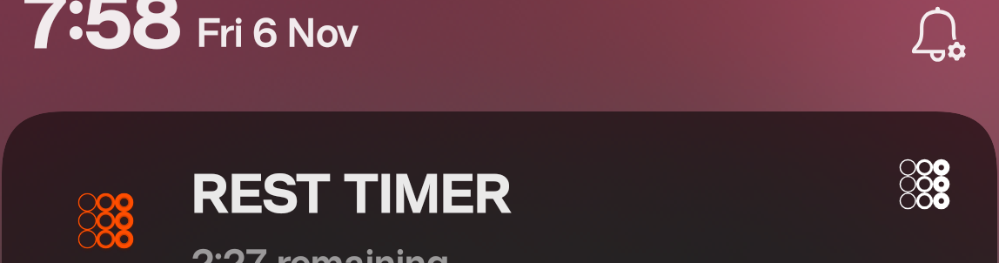
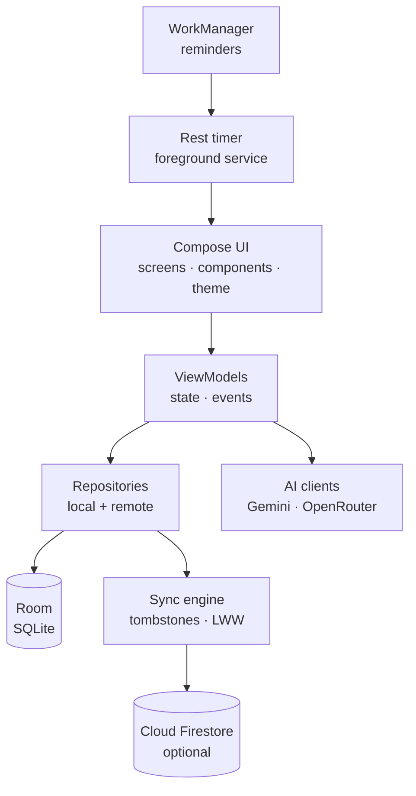

<p align="center">
  
</p>

<h1 align="center">Vital</h1>

<p align="center">
  <strong>Food, training and the numbers that matter — kept in one place.</strong>
</p>

<p align="center">
  A local-first Android fitness tracker for meals, lifting, cardio and the trends between them.
  Built with Kotlin, Jetpack Compose and Room. Cloud sync is optional; the app works fully offline.
</p>

<p align="center">
  
  
  
  
  
</p>

---

## Screenshots

<p align="center">
  
  
  
  
  
</p>

<p align="center">
  
  
  
</p>

---

## Features

### Track the day, not just the workout

- **Today** — a single daily view of calories left, protein/carbs/fat, water, weekly intake and completed workouts.
- **Meals** — breakfast, lunch, dinner and snacks with food search, recents, recipes, smart-text entry and a live macro breakdown.
- **Lift** — workout sessions, sets, weight, reps and RPE, a plate calculator, estimated 1RM, PR detection and a built-in rest timer.
- **Cardio** — run, walk, bike, row, swim and elliptical, with an ACSM calorie estimate and a treadmill-console photo scan.
- **Weeks** — 7-day, 4-week and 12-week adherence, weekly volume trends and body-weight history.
- **Progress** — body metrics, progress photos and trend charts, all stored locally.

### Built for real use

- **Offline-first** — Room is the source of truth. Every screen works without a network connection.
- **Optional cloud sync** — sign in with Google to keep a second device in step. Deletes propagate as tombstones; conflicts resolve last-writer-wins.
- **Android 16 Live Updates** — the rest timer is promoted to a status-bar chip with the transparent nine-ring Vital mark, plus `+15s` and `Done` actions.
- **Guided onboarding** — a short walkthrough, metric/imperial units, body-goal plan and editable targets.
- **Editorial themes** — multiple dark and light palettes, including a true-black mode.
- **In-app updates** — sideloaded builds check a small release manifest, show what changed, verify the APK checksum and hand it to the system installer. No store account required.
- **Optional AI coach** — Gemini or OpenRouter, with the API key encrypted on-device. The app is fully usable without a key.

> Vital is a personal project, not a medical device. Calorie and macro numbers are estimates.

---

## Tech stack

| Layer | Choice |
| --- | --- |
| Language | Kotlin 2.2 |
| UI | Jetpack Compose, Material 3 |
| Architecture | MVVM, unidirectional state, Hilt DI |
| Local data | Room (SQLite) with exported schemas and migrations |
| Async | Coroutines, Flow, WorkManager |
| Networking | OkHttp, kotlinx.serialization |
| Auth & cloud | Firebase Auth + Cloud Firestore (optional) |
| OCR | ML Kit text recognition (on-device) |
| Images | Coil |
| Performance | Baseline Profiles, R8 in release |
| Build | Gradle 9.6, AGP 9.4, JDK 17 |
| SDK | minSdk 28, targetSdk 36 |

---

## Architecture



The app follows a strict local-first rule:

1. A screen reads and writes Room through a repository.
2. The UI observes `Flow`s, so a write is visible immediately.
3. If the user is signed in, the sync engine pushes changed rows and pulls remote changes in the background.
4. The network is never on the critical path.

More detail: [`docs/ARCHITECTURE.md`](docs/ARCHITECTURE.md).

---

## Getting started

### Requirements

- JDK 17
- Android Studio (Ladybug or newer) with Android SDK 36
- An Android device or emulator running Android 8.0+ (API 28+)

### Build and install

```bash
git clone https://github.com/OWNER/REPO.git
cd REPO
./gradlew assembleDebug
adb install -r app/build/outputs/apk/debug/app-debug.apk
```

Or open the project in Android Studio and press **Run**.

The debug APK is large because it includes the bundled ML Kit model and both Firebase SDKs. Release builds are minified and noticeably smaller.

---

## Configuration

### Firebase (optional)

The app builds and runs without Firebase. Sign-in is disabled and Settings → Account explains that sync is not configured.

To enable Google sign-in and Firestore sync:

1. Create a Firebase project and an Android app with package `com.vital`.
2. Add your debug and release SHA-1 fingerprints.
3. Drop `google-services.json` into `app/`.
4. Enable Google sign-in and create a Firestore database.
5. Publish [`firestore.rules`](firestore.rules).

Full walkthrough: [`docs/FIREBASE_SETUP.md`](docs/FIREBASE_SETUP.md).

### In-app updates

The updater reads a release manifest from a URL baked into the build:

```properties
# local.properties
vital.updateManifestUrl=https://github.com/OWNER/REPO/releases/latest/download/latest.json
```

You can also pass it at build time:

```bash
./gradlew assembleRelease -Pvital.updateManifestUrl=https://example.com/latest.json
```

A blank value disables update checks. The release assets must be publicly reachable, so the
repository needs to be public (or the manifest and APK hosted elsewhere). The manifest schema,
signing rules and release checklist are in [`docs/UPDATES.md`](docs/UPDATES.md).

### Release signing

Create `keystore.properties` in the repository root (it is gitignored):

```properties
storeFile=/absolute/path/to/vital-release.jks
storePassword=…
keyAlias=vital
keyPassword=…
```

Release builds use that key automatically. Without the file they fall back to the debug key so local builds stay installable — but never distribute a debug-signed build if you plan to ship updates later.

> **Keep the release keystore and its passwords backed up.** Android will not install an update signed with a different key. Losing the key means a one-time uninstall and data loss for every user.

---

## Testing

```bash
./gradlew testDebugUnitTest     # unit tests
./gradlew compileDebugKotlin    # fast compile check
./gradlew assembleDebug         # full debug APK
```

The unit suite covers the nutrition parser, plate calculator, ACSM calorie estimate, adherence windows, estimated 1RM, PR detection, rest-timer state and other pure logic.

---

## Releasing an update

1. Bump `versionCode` and `versionName` in [`app/build.gradle.kts`](app/build.gradle.kts).
2. Update [`updates/release-notes.json`](updates/release-notes.json).
3. Commit, then tag and push:

   ```bash
   git tag v1.2.0
   git push origin v1.2.0
   ```

4. The **Release** workflow builds the signed APK, computes its SHA-256 and publishes a GitHub Release containing `Vital-1.2.0.apk` and `latest.json`.
5. The installed app checks `releases/latest/download/latest.json`, shows the release notes and offers **Update now** or **Later**. Data is preserved.

The first time, the user must allow **Install unknown apps → Vital**. Android still shows its own installer confirmation; no app can bypass it.

Details and a local test recipe: [`docs/UPDATES.md`](docs/UPDATES.md).

---

## Project structure

```
app/src/main/java/com/vital/
  ai/            AI clients, prompts and response parsing
  auth/          Google sign-in, account state
  data/          Room entities/DAOs, repositories, sync, updater
  domain/        Pure calculations and plan logic
  service/       Rest timer foreground service, boot receiver
  ui/            Compose screens, components, theme, navigation
  workers/       Reminder workers
baselineprofile/ Baseline Profile generator and benchmark
design/          Tab specs and visual references
docs/            Architecture, setup, measurements and audit notes
updates/         Release manifest template and notes
```

---

## Roadmap

- [x] Local-first meals, lift, cardio, today and weeks
- [x] Google sign-in and Firestore sync
- [x] Rest timer with Android 16 Live Updates
- [x] Guided onboarding and editable targets
- [x] In-app sideload updater
- [ ] Health Connect / step import
- [ ] Barcode scanning
- [ ] Routine templates and workout sharing
- [ ] Wear OS companion

Have a different priority? Open a feature request.

---

## Contributing

Contributions are welcome. Please read [`CONTRIBUTING.md`](CONTRIBUTING.md) and [`CODE_OF_CONDUCT.md`](CODE_OF_CONDUCT.md) first.

- Open an issue before a large change so the approach can be agreed on.
- Keep pull requests focused and include tests for logic changes.
- Run `./gradlew testDebugUnitTest` before opening a PR.

For security issues, **do not open a public issue** — follow [`SECURITY.md`](SECURITY.md).

---

## License

Released under the [MIT License](LICENSE).

---

## Acknowledgements

Vital stands on the Android open-source ecosystem: Jetpack Compose, Material 3, Room, Hilt, WorkManager, Firebase, ML Kit, OkHttp, Coil and kotlinx.serialization. Typography uses Inter Tight and JetBrains Mono under the SIL Open Font License.

<p align="center">
  <sub>Built for the gym, the kitchen and the long game.</sub>
</p>
